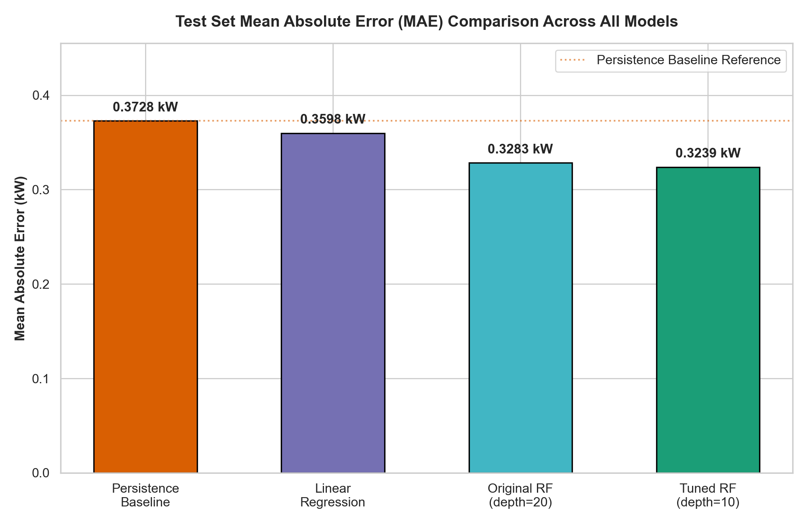
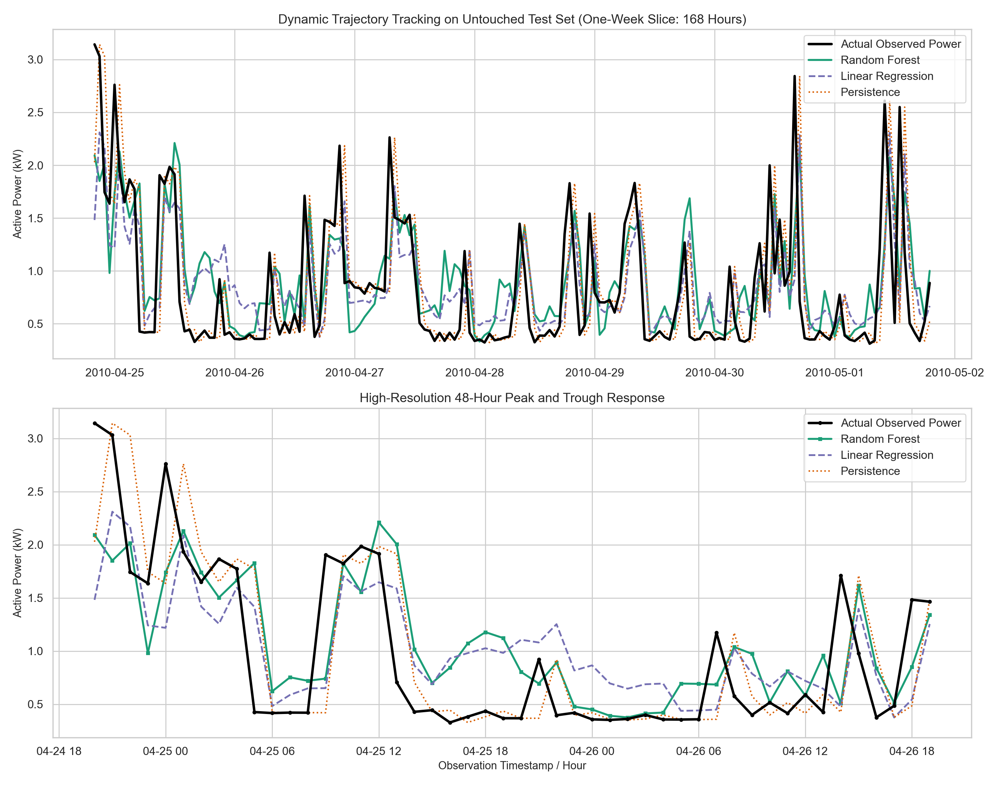

<p align="center">
  
</p>

# AI-Based Energy Consumption Prediction System

A reproducible machine learning pipeline that forecasts residential electricity consumption for the **next 1 hour** (in kilowatts, kW) using 4 years of historical smart-meter telemetry.

---

> ### ⚡ Active Machine Learning Service
> The complete implementation, model training code, test suite, and research reports live inside **[`ml-service/`](./ml-service/README.md)**.  
> 👉 **[Open ml-service/README.md for Complete ML Documentation](./ml-service/README.md)**

---

## 📁 Repository Structure

```text
energy-consumption-ai/
├── banner.svg                   # Visual repository banner
├── manual.html                  # Beginner-friendly viva & presentation guide
├── backend/                     # Backend API service (planned)
├── frontend/                    # Web dashboard (planned)
├── ml-service/                  # Active machine learning pipeline & models
│   ├── data/                    # Raw & processed hourly telemetry
│   ├── models/                  # Trained model artifacts (.joblib)
│   ├── notebooks/               # Exploratory data analysis notebooks
│   ├── reports/                 # Research reports, metrics & figures
│   ├── scripts/                 # Benchmark training & tuning entry points
│   ├── src/ml/                  # Core feature engineering & training logic
│   └── tests/                   # 41 passing automated unit tests
└── research/                    # Academic papers & references
```

---

## ⚡ Quick Start: Run Everything

Run the entire pipeline in 3 simple commands from the `ml-service` directory:

### 1. Install Dependencies
```powershell
cd ml-service
pip install -r requirements.txt
```

### 2. Run Test Suite (41 Tests Passed)
```powershell
python -m unittest discover -s tests -v
```

### 3. Run Next-Hour Power Prediction via CLI
Predict next-hour active power (kW) using the tuned model:
```powershell
python -m src.ml.predict --lag-1 1.25 --lag-2 1.10 --lag-3 1.05 --lag-24 1.30 --rolling-3h 1.13 --rolling-24h 1.22 --hour 18 --day-of-week 2 --model-path models/random_forest_tuned.joblib
```
**Output:**
```json
=== Prediction Result ===
{
  "prediction_kw": 1.5753,
  "unit": "kW",
  "horizon": "next_1_hour"
}
```

---

## 📊 Visual Results & Output Charts

### Primary Diagrams & Diagnostic Charts

Click any title to view or download the full-resolution vector or plot:

| Diagram / Chart Name | Clickable File Link | What It Displays |
| :--- | :--- | :--- |
| **System Architecture** | [figure_3_1_system_architecture.svg](./ml-service/reports/figures/figure_3_1_system_architecture.svg) | 7-stage offline training & evaluation pipeline |
| **Workflow Diagram** | [figure_3_2_workflow.svg](./ml-service/reports/figures/figure_3_2_workflow.svg) | 12-step data processing & model development sequence |
| **Model MAE Benchmark** | [model_mae_comparison_all_models.png](./ml-service/reports/figures/model_mae_comparison_all_models.png) | 4-model bar chart comparison on held-out test data |
| **Actual vs. Predicted Tracking** | [model_comparison_actual_vs_predicted.png](./ml-service/reports/figures/model_comparison_actual_vs_predicted.png) | 168-hour (1 week) time-series overlay + 48h zoom |
| **Hyperparameter Tuning Impact** | [model_tuning_comparison.png](./ml-service/reports/figures/model_tuning_comparison.png) | Validation MAE & RMSE drop from depth pruning |
| **Feature Importance Ranking** | [feature_importance.png](./ml-service/reports/figures/feature_importance.png) | MDI Gini importance showing `lag_1` dominance (~61%) |
| **Residual Error Distribution** | [error_summary.png](./ml-service/reports/figures/error_summary.png) | Prediction error histogram and KDE centered at 0 |

### Key Benchmark Comparison

[](./ml-service/reports/figures/model_mae_comparison_all_models.png)

### 1-Week Dynamic Trajectory Tracking

[](./ml-service/reports/figures/model_comparison_actual_vs_predicted.png)

---

## 📖 In-Depth Documentation

For full details on dataset preprocessing, mathematical error formulations, 20-configuration tuning results, and IEEE research paper drafts, visit:
* **[ml-service Documentation (`ml-service/README.md`)](./ml-service/README.md)**
* **[Final Experiment Summary (`ml-service/reports/final_experiment_summary.md`)](./ml-service/reports/final_experiment_summary.md)**
* **[Research Paper Draft (`ml-service/reports/conference_paper_draft.md`)](./ml-service/reports/conference_paper_draft.md)**
