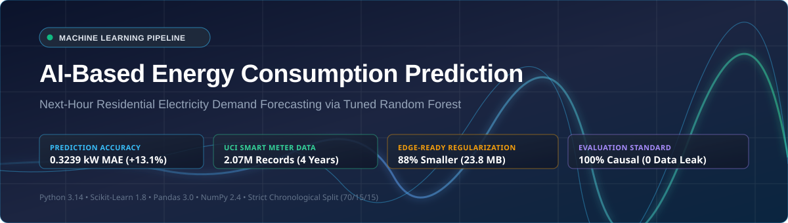

<p align="center">
  
</p>

# AI-Based Energy Consumption Prediction System

> ### ⚡ Active Implementation & Quick Links
> The complete, working machine learning pipeline is located in **[`ml-service/`](./ml-service/README.md)**.  
> 👉 **[Click here to view ml-service/README.md](./ml-service/README.md)** for execution instructions, runnable CLI tools, and benchmark comparisons.

---

## 📊 Visual Results & Diagrams

Click any of the links below to view high-resolution visual outputs:

| Diagram / Chart | Direct File Link | Preview Description |
| :--- | :--- | :--- |
| **System Architecture** | [figure_3_1_system_architecture.svg](./ml-service/reports/figures/figure_3_1_system_architecture.svg) | 7-stage offline training & evaluation pipeline |
| **Workflow Diagram** | [figure_3_2_workflow.svg](./ml-service/reports/figures/figure_3_2_workflow.svg) | 12-step end-to-end data processing workflow |
| **Model MAE Benchmark** | [model_mae_comparison_all_models.png](./ml-service/reports/figures/model_mae_comparison_all_models.png) | 4-model bar comparison on held-out test data |
| **Actual vs. Predicted Tracking** | [model_comparison_actual_vs_predicted.png](./ml-service/reports/figures/model_comparison_actual_vs_predicted.png) | 168-hour (1 week) time-series tracking & 48h zoom |
| **Hyperparameter Tuning** | [model_tuning_comparison.png](./ml-service/reports/figures/model_tuning_comparison.png) | Validation MAE & RMSE drop from depth pruning |
| **Feature Importance Ranking** | [feature_importance.png](./ml-service/reports/figures/feature_importance.png) | MDI Gini importance showing `lag_1` dominance |
| **Residual Error Distribution** | [error_summary.png](./ml-service/reports/figures/error_summary.png) | Prediction error histogram and KDE centered at 0 |

---

## 📁 Repository Structure

```text
energy-consumption-ai/
├── banner.svg            # Repository visual banner
├── backend/              # Backend application (planned)
├── frontend/             # User interface (planned)
├── ml-service/           # Active machine learning pipeline & models
└── research/             # Research publications & notes
```
