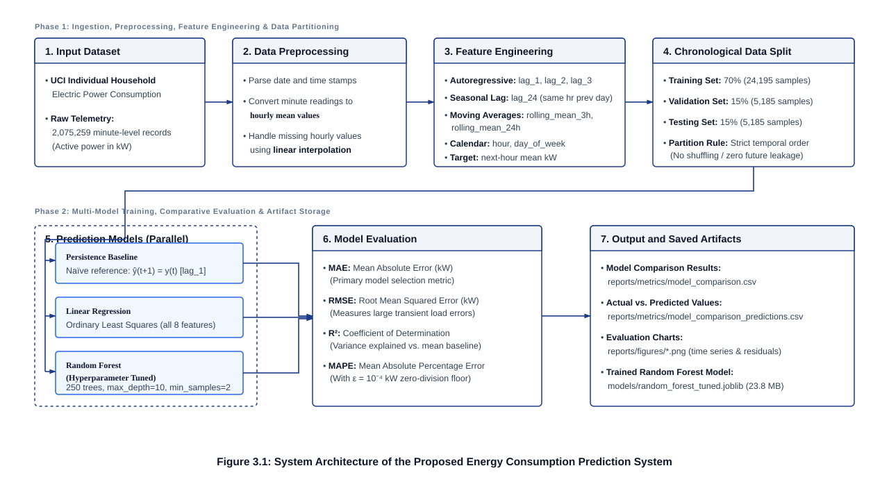
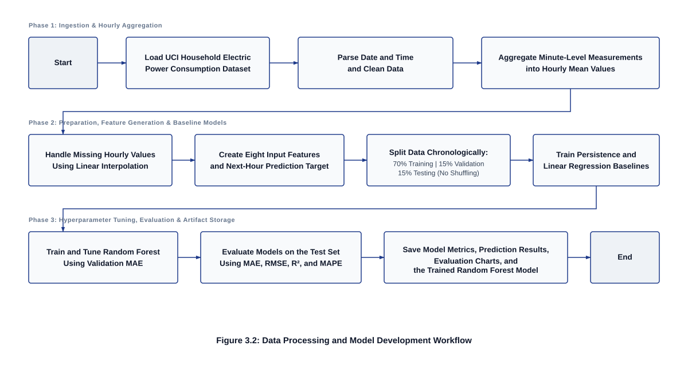
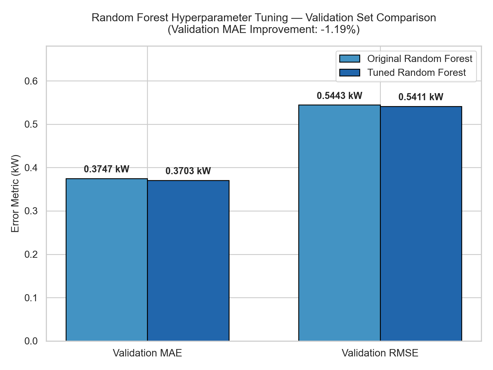
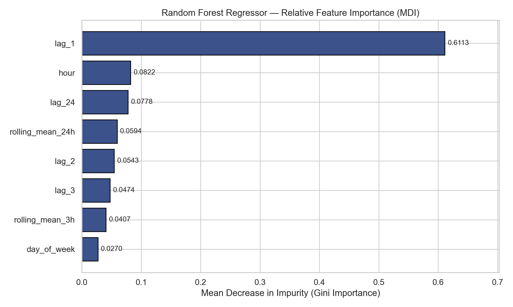
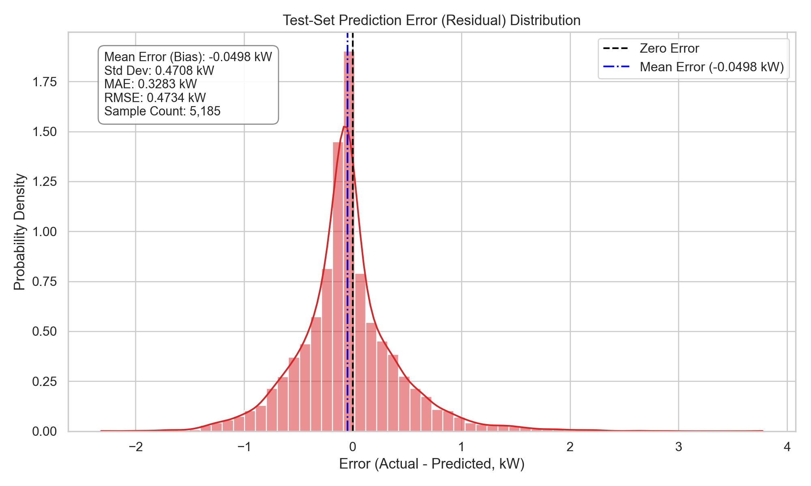

<p align="center">
  
</p>

# ML Service: AI-Based Energy Consumption Prediction System

A lightweight, reproducible machine learning pipeline that forecasts a household's electricity consumption for the **next 1 hour** (in kilowatts, kW) using 4 years of real smart-meter telemetry.

---

## 📌 At a Glance

* **Goal:** Predict next hour's mean active power (`Global_active_power`, kW).
* **Dataset:** UCI Individual Household Electric Power Consumption (2,075,259 minute-level rows aggregated to 34,589 hourly steps).
* **Features:** 8 leak-free features derived strictly from past data (lags, rolling averages, calendar hour/day).
* **Evaluation Split:** Strict chronological split — **70% Train** (24,195), **15% Validation** (5,185), **15% Held-Out Test** (5,185).
* **Winning Model:** **Tuned Random Forest** (250 trees, max_depth=10) with **0.3239 kW Test MAE** (a **13.12% error reduction** over baseline) and **88% smaller file size** (23.8 MB vs 201.7 MB).

---

## ⚡ Quick Start: Run Everything

### 1. Install Dependencies
```powershell
pip install -r requirements.txt
```

### 2. Run Automated Tests (41 Tests Passed)
```powershell
python -m unittest discover -s tests -v
```
**Output:**
```text
Ran 41 tests in 3.363s

OK
```

### 3. Make an Instant Prediction via CLI
Predict next-hour power consumption using past 8 features:
```powershell
python -m src.ml.predict --lag-1 1.25 --lag-2 1.10 --lag-3 1.05 --lag-24 1.30 --rolling-3h 1.13 --rolling-24h 1.22 --hour 18 --day-of-week 2 --model-path models/random_forest_tuned.joblib
```
**Output:**
```json
=== Prediction Result ===
{
  "prediction_kw": 1.5753,
  "unit": "kW",
  "horizon": "next_1_hour",
  "input_features": {
    "lag_1": 1.25,
    "lag_2": 1.1,
    "lag_3": 1.05,
    "lag_24": 1.3,
    "rolling_mean_3h": 1.13,
    "rolling_mean_24h": 1.22,
    "hour": 18.0,
    "day_of_week": 2.0
  }
}
```

### 4. Train & Benchmark All Models
```powershell
python scripts/train_model.py
```

### 5. Run Hyperparameter Tuning
```powershell
python scripts/tune_model.py
```

---

## 📊 Experimental Results

Evaluated across the exact same 5,185 held-out test hours:

| Model | Test MAE (kW) | Test RMSE (kW) | Test $R^2$ | Test MAPE (%) | Error Reduction vs. Baseline | Model File Size |
| :--- | :---: | :---: | :---: | :---: | :---: | :---: |
| **Persistence Baseline** | 0.3728 | 0.5752 | 0.3291 | 44.75% | Baseline Ref | *None* |
| **Linear Regression** | 0.3598 | 0.5058 | 0.4811 | 50.08% | +3.49% | < 0.1 MB |
| **Original Random Forest** | 0.3283 | 0.4734 | 0.5454 | 44.78% | +11.94% | 201.7 MB |
| **Tuned Random Forest** | **0.3239** | **0.4682** | **0.5555** | **44.19%** | **+13.12%** | **23.8 MB (-88%)** |

> **Key Finding:** Restricting tree depth from 20 to 10 acts as regularization against sudden household load spikes. It improved test accuracy while shrinking the model file from **201.7 MB to 23.8 MB**, making it ideal for real-world smart meter edge devices.

---

## 🖼️ Visual Results & Diagrams Catalog

Click on any image to view it in full resolution.

### 1. System Architecture (Figure 3.1)
*7-stage offline training & evaluation pipeline:*
[](./reports/figures/figure_3_1_system_architecture.svg)

---

### 2. End-to-End Workflow Diagram (Figure 3.2)
*12-step data processing & model development sequence:*
[](./reports/figures/figure_3_2_workflow.svg)

---

### 3. Model MAE Benchmark Comparison
*4-model bar comparison on held-out test data:*
[](./reports/figures/model_mae_comparison_all_models.png)

---

### 4. Actual vs. Predicted Tracking
*168-hour (1 week) time-series tracking & 48h zoom:*
[](./reports/figures/model_comparison_actual_vs_predicted.png)

---

### 5. Hyperparameter Tuning Impact
*Validation MAE & RMSE drop from depth pruning (max_depth=10):*
[](./reports/figures/model_tuning_comparison.png)

---

### 6. Feature Importance Ranking
*MDI Gini importance showing `lag_1` dominance (~61%), followed by calendar `hour` and `lag_24`:*
[](./reports/figures/feature_importance.png)

---

### 7. Residual Error Distribution
*Prediction error histogram and Kernel Density Estimation centered around 0 kW:*
[](./reports/figures/error_summary.png)

---

## 📁 Repository Structure

```text
ml-service/
├── data/
│   ├── raw/household_power_consumption.txt    # Raw 2M+ readings (133 MB)
│   └── processed/hourly_consumption.csv       # Cleaned hourly series (34,589 rows)
├── models/
│   ├── random_forest_tuned.joblib             # Best model (23.8 MB)
│   ├── random_forest.joblib                   # Original model (201.7 MB)
│   └── random_forest_tuned_metadata.json      # Complete parameters and scores
├── reports/
│   ├── figures/                               # All generated 200 DPI charts and SVGs
│   ├── metrics/                               # Metrics CSVs and prediction outputs
│   └── final_experiment_summary.md            # Detailed academic summary
├── scripts/
│   ├── train_model.py                         # Runs baseline benchmark
│   └── tune_model.py                          # Runs 20-configuration grid search
├── src/
│   └── ml/
│       ├── features.py                        # 8 leak-free features
│       ├── predict.py                         # CLI inference tool
│       ├── preprocessing.py                   # Chronological splitting
│       ├── train.py                           # Benchmark training logic
│       └── tune.py                            # Tuning search logic
├── tests/                                     # 41 unit tests
└── requirements.txt                           # Dependencies
```
